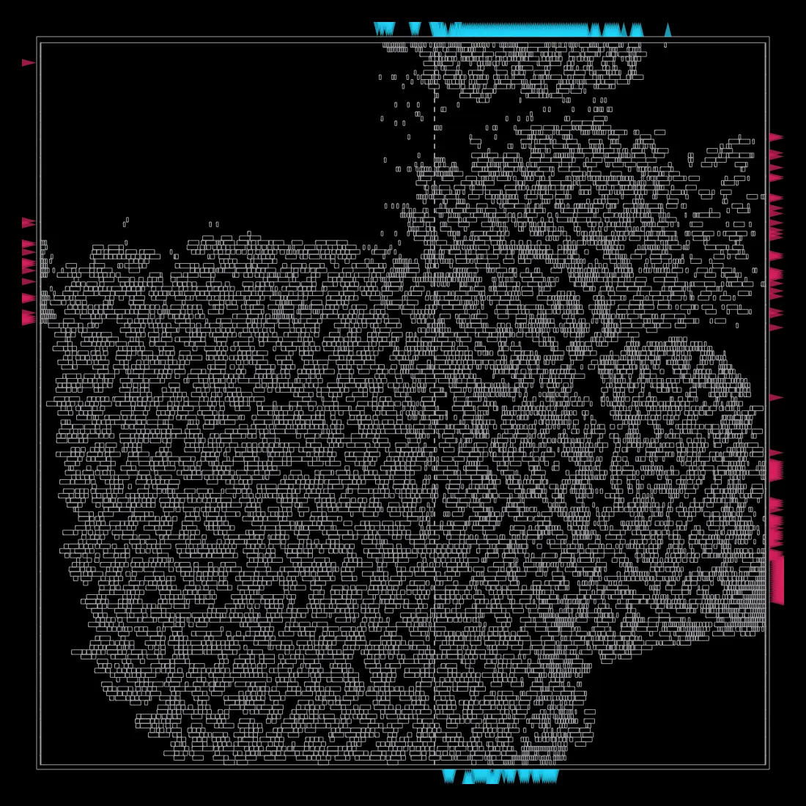
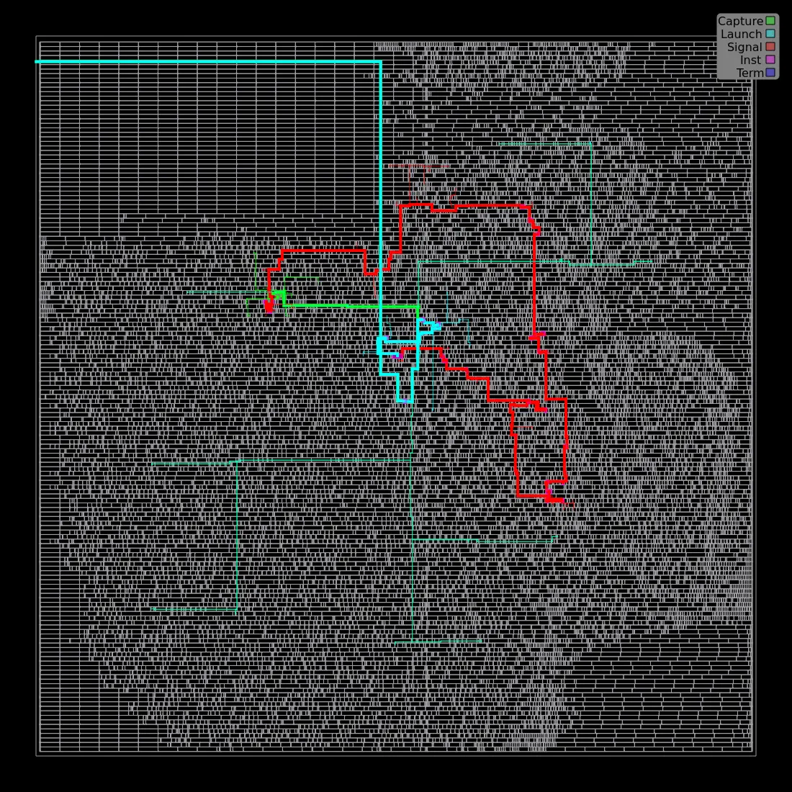

# RV32I Single-Cycle and Five-Stage Pipeline Processors

SystemVerilog implementations of a **37-instruction RV32I subset**, with
single-cycle and five-stage pipeline cores, automated cocotb verification,
and reproducible cycle/CPI comparisons.

## Architecture

- Separate `rv32i_core` and `rv32i_pipeline_core` tops sharing the ALU,
  decoder, register file, and immediate generator.
- IF, ID, EX, MEM, and WB stages with EX/MEM and MEM/WB forwarding and
  WB-to-ID bypass.
- One-cycle load-use stalls; EX-resolved branches, JAL, and JALR with
  two-slot flushes.
- Valid/reset-gated writes and little-endian byte-write strobes for
  byte, halfword, and word memory accesses.

See the [datapath diagrams](docs/datapath.md) and
[control table](docs/control_table.md).

## Verification

Latest full regression, reference checks, coverage, matched benchmarks,
synthesis and STA rerun: **2026-11-07**. The
[dated run manifest](reports/verification/20261107T121922Z/manifest.json)
records source hashes, tool versions, commands and raw outputs.

`make regression` runs **74 cocotb cases across 17 Verilator targets**:
44 module-level, 20 single-cycle integration/benchmark and 10 pipeline
integration cases. Tests check instruction results, x0, reset, subword
memory, forwarding, load-use stalls, and suppression of wrong-path
register/memory writes.

Both cores passed Yosys structural checks. Detailed test assertions,
vector counts, and reproduction instructions are in
[verification](docs/verification.md); mapped results and STA are in
[synthesis and timing](docs/synthesis.md).

## Cycle and CPI comparison

Measured cycles on hazard workloads match the zero-wait-memory model
`C = N + 4 + L + 2R`: retired instructions, four fill cycles, one cycle per
load-use stall, and two per taken EX redirect. The same machine-code programs
and retirement-PC sequences run on both cores. Cycles exclude reset.

| Optional matched workload | N | Single-cycle cycles | Pipeline cycles | L | R |
| --- | ---: | ---: | ---: | ---: | ---: |
| Independent ALU | 512 | 512 | 516 | 0 | 0 |
| Dependent ALU | 512 | 512 | 516 | 0 | 0 |
| Branch loop | 771 | 771 | 1,285 | 0 | 255 |
| Repeated load-use | 259 | 259 | 391 | 128 | 0 |

`make benchmark SEED=20261006` runs these four workloads on each core
(separate from the default 74). With no hazards the pipeline needs only the
four fill cycles (512 → 516); each taken branch costs two cycles and each
load-use pair one. See the [measurement method](docs/verification.md#cycle-and-cpi-measurements).

## Synthesis and STA

Yosys maps both cores to Nangate45 (typical corner); OpenSTA analyses them
core-only and pre-layout at a 10 ns ideal clock (0.1 ns setup uncertainty,
0.5 ns I/O delay):

| Metric | Single-cycle | Pipeline |
| --- | ---: | ---: |
| Worst setup slack | +5.202 ns | +6.182 ns |
| Critical arrival / required | 4.198 / 9.400 ns | 3.676 / 9.857 ns |
| Mapped cells | 6,267 | 9,565 |
| Liberty cell-area sum | 12,737.410 | 17,551.212 |
| Max-slew violating report rows | 49 | 1,580 |
| Max-capacitance violating report rows | 91 | 84 |

Critical paths: instruction input `instr[21]` through decode, register read
and store-data selection to `data_write_data[10]` (single-cycle); IF/ID rs1
address bit → register-file read mux → ID/EX `rs1_data[0]` (pipeline).
The worst max-slew violators are the register-address flops (e.g. the rs1
address bit above) that fan out across the 32-entry register-file read mux;
these still need buffering or upsizing, so the slack is not quoted as an Fmax.

## Physical implementation

The pipeline core is taken from RTL to GDS with OpenROAD-flow-scripts on
Nangate45 (synthesis, floorplan, placement, CTS, routing), using the same SDC
with only the clock period swept. After placement repair the pre-layout
max-slew violations above are gone, routing is DRC-clean at every clock, and
each routed netlist is formally equivalent to synthesis.

| Clock | WNS / TNS (ns) | Max-slew viol. | Std-cell area (µm²) | Power |
| ---: | ---: | ---: | ---: | ---: |
| 10.0 ns (100 MHz) | +8.228 / 0 | 0 | 20,339 | 2.48 mW |
| 2.0 ns (500 MHz) | +0.367 / 0 | 0 | 20,337 | 10.84 mW |
| 1.6 ns (625 MHz) | +0.076 / 0 | 0 | 20,425 | 13.50 mW |
| **1.4 ns (714 MHz)** | **+0.005 / 0** | 0 | 20,543 | 15.29 mW |
| 1.2 ns (833 MHz) | −0.015 / −0.125 | 0 | 21,496 | 17.85 mW |

The fastest closing clock is 1.4 ns. The first sweep closed only at 1.6 ns:
the STA paths showed an EX branch redirect used as `flush` that cleared every
ID/EX field (~200 flops) and a `reset` → `data_write_data` feed-through from
reset-gating the store data. Flush and bubble now clear only valid and the
write/branch/jump controls, and reset gates only `data_write_en`; at 1.4 ns WNS
went from −0.006 to +0.005 ns and at 1.2 ns TNS from −14.647 to −0.125 ns.
The 1.2 ns limiter is now forwarding → 32-bit ALU → EX/MEM.

| Cell placement (1.4 ns) | Worst setup path (1.4 ns) |
| :---: | :---: |
|  |  |

Left: placed standard cells with the I/O pins on the die edge; at 40 % core
utilisation the placer leaves the upper-left corner mostly empty. Right: the
worst setup path at 1.4 ns (red) runs between flops inside the core; in the
first sweep it ran from the `reset` pin across the die to a `data_write_data`
output pin.

The full sweep, remaining max-cap violators, limiting-path analysis, images
and reproduction steps are in [pnr/README.md](pnr/README.md).

## Supported instructions

- Arithmetic/logic: ADD, ADDI, SUB, AND, ANDI, OR, ORI, XOR, XORI
- Comparisons: SLT, SLTI, SLTU, SLTIU
- Shifts: SLL, SLLI, SRL, SRLI, SRA, SRAI
- Memory: LB, LBU, LH, LHU, LW, SB, SH, SW
- Branches: BEQ, BNE, BLT, BGE, BLTU, BGEU
- Upper immediates/jumps: LUI, AUIPC, JAL, JALR

## Known limitations

- Excluded RV32I base instructions: FENCE, ECALL, EBREAK.
- Also unsupported: Zicsr CSR instructions, Zifencei FENCE.I, privileged MRET,
  exceptions/traps and interrupts.
- External zero-wait memory models; naturally aligned halfword/word accesses
  and four-byte-aligned instruction addresses.
- Pre-layout STA is typical-corner and core-only. The OpenROAD post-route
  results are single-corner (typical) on the educational Nangate45 library
  with assumed I/O budgets; they are not a physical signoff.

The [specification](docs/specification.md) defines the complete interface
contract. Detailed [verification limits](docs/verification.md#verification-limits)
and [timing limits](docs/synthesis.md#interpretation) accompany the results.

## Documentation

| Document | Contents |
| --- | --- |
| [Specification](docs/specification.md) | Instruction semantics, interfaces, reset, and memory contract |
| [Datapath](docs/datapath.md) | Pipeline boundaries, forwarding, and single-cycle architecture |
| [Control table](docs/control_table.md) | Decode qualification and control-signal encodings |
| [Verification](docs/verification.md) | Tests, benchmarks, sampling, and reproduction |
| [Synthesis and timing](docs/synthesis.md) | Tools, library identity, constraints, and reports |
| [Debugging notes](docs/debugging_notes.md) | Symptoms, root causes, fixes, and verification |
| [Physical implementation](pnr/README.md) | OpenROAD flow, clock sweep, limiting paths, and reproduction |

Source is under `rtl/`, tests under `tb/`, and timing constraints/scripts
under `timing/`. Generated test results and waveforms stay under ignored
`build/`; `reports/timing/` contains the two saved STA analysis reports,
and `pnr/` with `reports/pnr/` holds the OpenROAD config and saved results.

## Quick start

Run from the repository root on Linux or WSL Ubuntu with Python 3.12,
GNU Make, and Verilator. The recorded simulator version is Verilator 5.050;
Python dependencies are pinned in `requirements.txt`.

```sh
python3 -m venv .venv
. .venv/bin/activate
python -m pip install -r requirements.txt
make lint-core lint-pipeline
make regression SEED=20261006
make benchmark SEED=20261006
```

`make test-pipeline-core` runs the
integrated pipeline tests; `make test` alone runs only the full-adder component.
Waveform instructions are in [verification](docs/verification.md#reports-and-reproduction).

## License and references

Project source is available under the [MIT License](LICENSE).
EDA tools and cell libraries are obtained separately and retain their own
licenses; they are not bundled with this repository.

Instruction semantics follow the
[RISC-V unprivileged ISA specification](https://docs.riscv.org/reference/isa/v20240411/unpriv/rv32.html).
